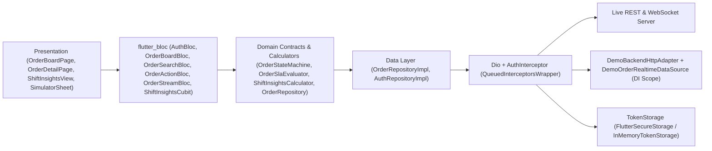
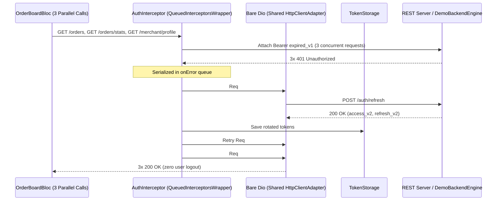
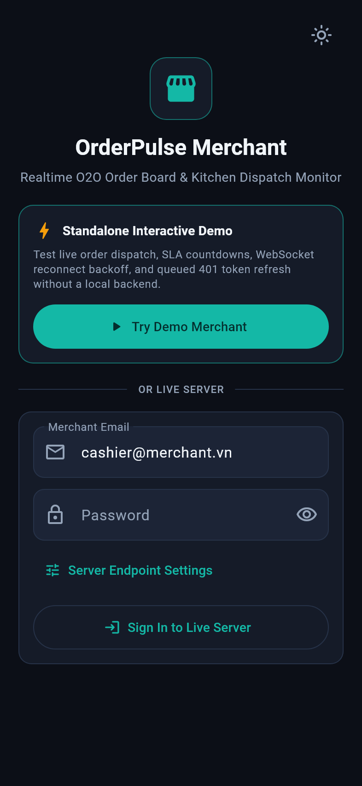
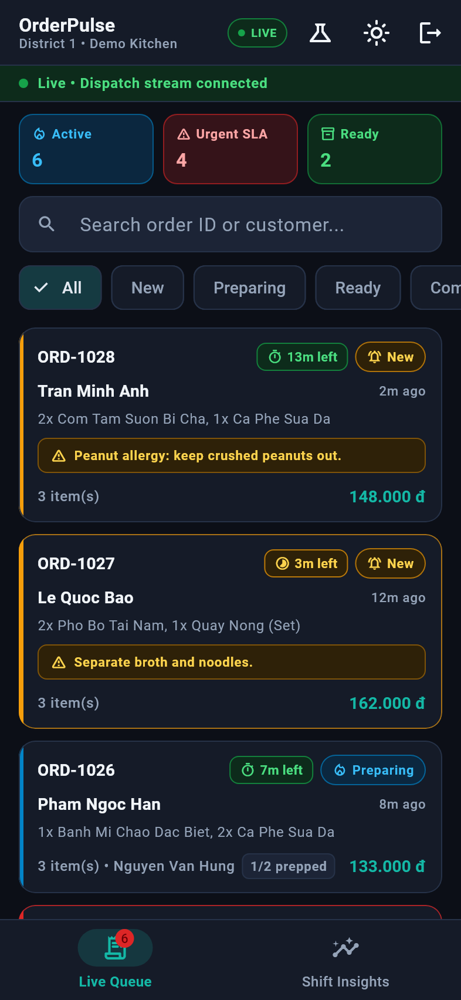
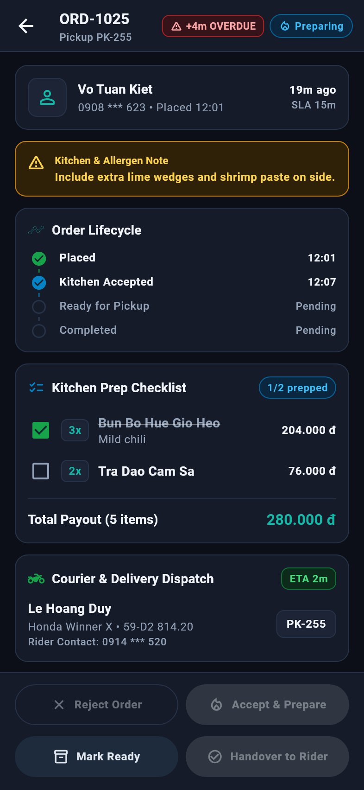
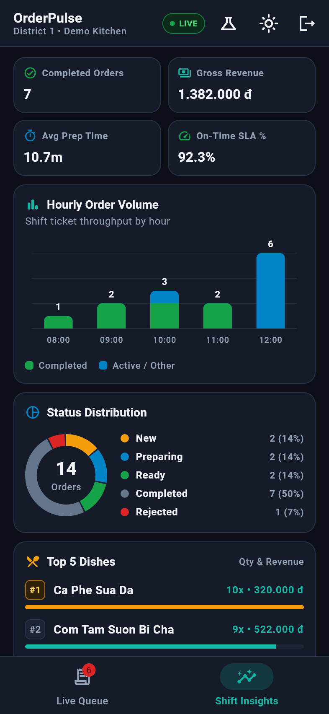
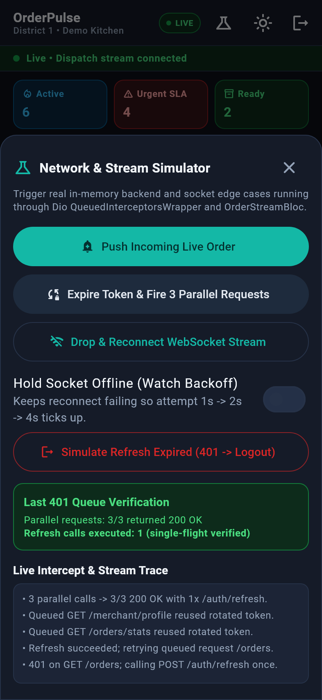

# OrderPulse — Realtime Merchant Order & Kitchen Dispatch Monitor

> **One-sentence pitch:** A real-time O2O merchant Kitchen Display System (KDS) and dispatch app built with **Flutter**, **BLoC (`Bloc` / `Cubit` + `bloc_concurrency`)**, **Dio (`QueuedInterceptorsWrapper`)**, **WebSockets**, and **CustomPainter** shift analytics—featuring single-flight JWT refresh, live `AppClock`-driven prep SLA countdowns, interactive per-item prep checklists, and a standalone interactive demo mode.

[](https://github.com/bachiep/orderpulse-flutter/actions/workflows/ci.yml)
[](https://github.com/bachiep/orderpulse-flutter/releases/tag/v1.0.0)


[](LICENSE)

---

## 1. Overview & Motivation

- **Problem:** Realtime O2O merchant & kitchen dispatch dashboards commonly break in production under four operational failure modes:
  1. **Concurrent `401` Refresh Races:** Firing multiple dashboard APIs simultaneously as a short-lived access token expires triggers parallel `/auth/refresh` requests, causing false logouts under refresh-token rotation.
  2. **Missed Prep SLA Windows & Unchecked Line Items:** Static order timestamps force cooks to calculate prep urgency manually and mark tickets ready without line-by-line verification.
  3. **Duplicate Dispatch Writes & Invalid Transitions:** Rapid double-taps on "Accept & Prepare" submit duplicate `PATCH` mutations, while weak UI-only checks allow skipping kitchen preparation stages or rejecting orders without a reason.
  4. **Aggressive WebSocket Reconnect Loops & Resource Leaks:** Dropping Wi-Fi/cellular causes tight retry loops or leaked `Timer` and `StreamSubscription` instances across sign-out transitions.
- **Solution:** OrderPulse separates transport concerns behind domain repository interfaces wired via `get_it` scopes, enabling both **Live Server Mode** (`Dio` + `WebSocketChannel` + `FlutterSecureStorage`) and **Standalone Interactive Demo Mode** (an in-memory `HttpClientAdapter` + controllable stream source running through the exact same `Dio` interceptors and BLoCs), wrapped in a high-contrast KDS Dark/Light interface (`v2.0.0`).

---

## 2. System Architecture



### Queued `401` Refresh & WebSocket Reconnect Flow



### Key Technical Highlights (What to Inspect)

- **Single-Flight `QueuedInterceptorsWrapper` (`lib/core/network/auth_interceptor.dart` & `dio_client.dart`):**
  - Serializes `401` handling so 3 concurrent expired-token calls trigger **exactly 1** `/auth/refresh` request.
  - Uses an isolated bare `Dio` factory sharing the active `HttpClientAdapter` (without `AuthInterceptor`) to prevent queue re-entrancy deadlocks during refresh and retries, and clears credentials + notifies `AuthBloc` if refresh itself returns `401`.
- **High-Contrast KDS Theme & Live `AppClock` SLA Engine (`lib/core/theme/app_theme.dart`, `lib/features/orders/domain/order_sla.dart`):**
  - Defaults to OLED-friendly KDS Dark (`#0C0F17` canvas, `#151B28` cards, `1px` crisp borders) with instant Daylight Light mode toggle, semantic status tokens (`NEW` Amber `#F59E0B`, `PREPARING` Sky `#0284C7`, `READY` Emerald `#16A34A`, `COMPLETED` Slate `#64748B`, `REJECTED`/`OVERDUE` Crimson `#DC2626`), and `FontFeature.tabularFigures()` across metrics and countdowns.
  - `OrderSlaEvaluator` computes 15-minute target prep SLA countdown badges (`13m left` -> `3m left` -> `+4m OVERDUE`) with lifecycle-safe periodic refresh timers cancelled cleanly on `dispose()`.
- **Enriched Dispatch Workspace & State-Machine Guards (`lib/features/dispatch/`):**
  - `OrderDetailPage` renders a timestamped Order Lifecycle Stepper (`Placed`, `Kitchen Accepted`, `Ready for Pickup`, `Completed`/`Rejected`), an interactive Per-Item Kitchen Prep Checklist (`X/Y prepped`) persisted via `PATCH /orders/:id/items/:index`, allergen/kitchen note banners, and a Courier & Delivery Dispatch card.
  - `OrderActionBloc` uses `droppable()` to drop double-taps, paired with pure-domain `OrderStateMachine` (`NEW -> PREPARING -> READY -> COMPLETED` or `NEW -> REJECTED` with a non-empty rejection reason).
- **2-Tab Navigation Shell & `CustomPainter` Shift Insights (`lib/features/insights/`):**
  - `ShiftInsightsCalculator` dynamically derives `Completed Orders`, `Gross Revenue`, `Avg Prep Time`, `On-Time SLA %`, hourly volume buckets, status mix, and ranked **Top 5 Dishes** from live shift orders, visualized via custom `HourlyVolumeChart` and `StatusDistributionChart` `CustomPainter`s.
- **Bounded Exponential-Backoff WebSocket Stream (`lib/features/realtime/presentation/bloc/order_stream_bloc.dart`):**
  - Processes `ORDER_CREATED`, `ORDER_CANCELLED`, and `RIDER_ASSIGNED` events with bounded exponential backoff (`1s -> 2s -> 4s -> 8s -> max 16s`) and explicit `Timer` + `StreamSubscription` cancellation in `close()`.
- **Clean DI Mode Switching (`lib/core/di/injection.dart`):**
  - Swaps between Demo and Live environments via `get_it` scopes (`environment-scope`)—keeping UI widgets and Blocs completely free of `if (isDemo)` branches.

---

## 3. Tech Stack

| Layer | Technology | Purpose |
| :--- | :--- | :--- |
| Language & Runtime | Dart `3.11.4` / Flutter `3.41.6` | Sound null safety, `sealed class Result<T>` & `Failure` exhaustive pattern matching |
| State Management | `flutter_bloc`, `bloc_concurrency`, `equatable` | Unidirectional data flow, `restartable()` search debounce, `droppable()` dispatch actions |
| Navigation & DI | `go_router`, `get_it` | Auth-guarded declarative routing (`AuthSessionGate`), scoped Live/Demo DI container |
| Networking & Security | `dio`, `web_socket_channel`, `flutter_secure_storage` | `QueuedInterceptorsWrapper` refresh queue, live WebSocket stream, Keystore/Keychain JWT storage |
| UI & Visualization | Material 3 (`useMaterial3: true`), `CustomPainter`, `intl` | KDS Dark/Light themes, custom bar/donut charts, tabular figures, VND formatting, 320px-safe layouts |
| Testing | `flutter_test`, `bloc_test`, `mocktail` | Real `Dio` `HttpClientAdapter` concurrency tests, `FixedClock` SLA/insights tests, widget & overflow tests |

---

## 4. Quick Start (Run Locally or Test Standalone APK)

### Option A — Standalone Interactive Demo APK (No Backend Required)
1. Download `app-release.apk` from [**GitHub Releases (`v1.0.0` latest release; `v2.0.0` release follows merge)**](https://github.com/bachiep/orderpulse-flutter/releases/tag/v1.0.0) and install on Android.
2. On the login screen, tap **"Try Demo Merchant"** to enter the pre-seeded KDS Dark kitchen dispatch board immediately.
3. Tap any order card to toggle the **Kitchen Prep Checklist**, step through **Order Lifecycle** transitions, or switch to the **Shift Insights** bottom tab.
4. Tap the **Simulator (`science` icon)** in the top bar to test:
   - **Push Incoming Live Order** (live WebSocket `ORDER_CREATED` alert banner + prepend)
   - **Expire Token & Fire 3 Parallel Requests** (live `Dio` trace showing `3/3 200 OK` with `1x /auth/refresh`)
   - **Drop & Reconnect WebSocket Stream** / **Hold Socket Offline** (watch `Reconnecting (attempt 1 -> 2 -> 3)` backoff)
   - **Simulate Refresh Expired (`401 -> Logout`)** (verifies token wipe & auth guard redirect)

### Option B — Run From Source (Demo or Live Server Mode)
**Prerequisites:** Flutter SDK `3.41.x+` (Dart `3.11+`), Android Studio / Emulator or Chrome.

```bash
cp .env.example .env
flutter pub get

# 1. Default standalone Interactive Demo Mode
flutter run

# 2. Live Server Mode (Android Emulator uses 10.0.2.2 to reach host localhost)
flutter run \
  --dart-define=APP_ENV=live \
  --dart-define=API_BASE_URL=http://10.0.2.2:8301 \
  --dart-define=WS_BASE_URL=ws://10.0.2.2:8301/ws/orders

# 3. Live Server Mode on iOS Simulator, Desktop, or Web
flutter run \
  --dart-define=APP_ENV=live \
  --dart-define=API_BASE_URL=http://localhost:8301 \
  --dart-define=WS_BASE_URL=ws://localhost:8301/ws/orders
```

---

## 5. Core Screens & Workflow

### Mobile UI Preview (`393x852 @2x`, KDS Dark Default)

| Demo Login & Live Config | Live Order Board & SLA Badges | Kitchen Detail & Prep Checklist | Shift Insights Analytics | 401 Queue & Stream Simulator |
| :---: | :---: | :---: | :---: | :---: |
|  |  |  |  |  |
| 1-tap Demo Merchant entry + collapsible Live endpoint settings | Unclipped 2-line AppBar, `LIVE` pill, queue KPIs, and SLA countdown badges | Lifecycle stepper, interactive prep checklist (`1/2 prepped`), and rider card | KPI grid, `CustomPainter` hourly bar & donut charts, and Top 5 Dishes | Live `3x 401 -> 1x /auth/refresh` verification right on device |

1. **Login & Server Config (`LoginPage`):** 1-tap Demo Merchant entry alongside expandable Live Server endpoint settings (`API_BASE_URL`, `WS_BASE_URL`), theme toggle, and keyboard-safe scroll insets.
2. **Live Queue (`OrderBoardPage` Tab 1):** Unclipped 2-line AppBar (`OrderPulse` + `District 1 • Demo Kitchen`), compact `LIVE`/`SYNCING`/`OFFLINE` status pill, queue summary strip (`Active` / `Urgent SLA` / `Ready`), debounced search, status filter chips, SLA-badged cards, infinite scroll (`Load More`), pull-to-refresh, and all 4 explicit UI states (`Loading`, `Loaded`, `Empty` CTA, `Error` Retry).
3. **Kitchen Ticket & Dispatch (`OrderDetailPage` & `RejectOrderDialog`):** Timestamped Order Lifecycle Stepper, interactive Per-Item Kitchen Prep Checklist (`X/Y prepped`), allergen/kitchen note banner, Courier & Delivery Dispatch card, disabled invalid transitions in the 2x2 bottom action bar, and mandatory non-empty rejection reason dialog.
4. **Shift Insights (`ShiftInsightsView` Tab 2):** Real-time KPI grid (`Completed Orders`, `Gross Revenue`, `Avg Prep Time`, `On-Time SLA %`), `CustomPainter` Hourly Order Volume Bar Chart, Status Distribution Donut Ring, and dynamically ranked Top 5 Dishes.
5. **Network & Stream Simulator (`SimulatorSheet`):** Real-time verification of `AuthInterceptor` queueing and `OrderStreamBloc` exponential-backoff recovery right on device.

---

## 6. Testing & Verification

```bash
flutter analyze --no-pub
flutter test --no-pub --concurrency=1 --timeout 30s
flutter build apk --release
```

Verified locally:
- **`flutter analyze --no-pub`:** `No issues found!`
- **`flutter test --no-pub --concurrency=1 --timeout 30s`:** **`52/52` tests passed** across `17` test files, covering:
  - Real `Dio` + custom `HttpClientAdapter` proving 3 concurrent `401` calls trigger exactly `1` `/auth/refresh` and all 3 retry & succeed, plus refresh `401` logout (`test/core/auth_interceptor_test.dart`).
  - `OrderSlaEvaluator` deterministic countdown transitions (`11m left` -> `3m left` -> `+4m OVERDUE`) using `FixedClock` (`test/features/orders/order_sla_test.dart`).
  - `ShiftInsightsCalculator` & `ShiftInsightsCubit` KPI, hourly volume, status mix, and Top 5 Dishes ranking (`test/features/insights/shift_insights_test.dart`).
  - `AuthBloc`, `OrderBoardBloc` pagination/empty/error states, `OrderSearchBloc` `restartable()` debounce, and `OrderActionBloc` `droppable()` + `OrderStateMachine` invariants.
  - `OrderStreamBloc` bounded exponential backoff (`1s -> 2s -> 4s -> 8s -> max 16s`), recovery, and timer cleanup on `close()`.
  - Widget tests for all 4 UI states, unclipped 2-line AppBar at `393px`, interactive prep checklist toggling, `Shift Insights` rendering, disabled invalid dispatch buttons, mandatory rejection reason validation, and narrow `320px` + open keyboard `viewInsets` overflow safety.

---

## 7. Project Structure

```text
lib/
├── app.dart
├── main.dart
├── core/
│   ├── config/app_config.dart
│   ├── di/injection.dart
│   ├── error/failures.dart
│   ├── network/
│   │   ├── auth_interceptor.dart
│   │   ├── dio_client.dart
│   │   ├── dio_error_mapper.dart
│   │   └── token_storage.dart
│   ├── result/result.dart
│   ├── router/app_router.dart
│   ├── theme/{app_theme.dart, theme_cubit.dart}
│   ├── time/app_clock.dart
│   └── widgets/{state_views.dart, status_badge.dart}
└── features/
    ├── auth/{data, domain, presentation}/
    ├── dispatch/{domain, presentation}/
    ├── insights/{domain, presentation}/
    ├── orders/{data, domain, presentation}/
    ├── realtime/{data, domain, presentation}/
    └── simulator/{data, domain, presentation}/
```

---

## 8. Future Improvements & Known Tradeoffs

- **Offline Order Queue Cache:** Orders currently require an active session/network (or Demo adapter) rather than persisting a local SQLite cache; adding a `Drift` read cache would allow viewing recent kitchen tickets across full network blackouts.
- **Release Signing Keystore:** Release builds currently use Flutter's default debug-key signing placeholder in `android/app/build.gradle.kts` (`*.jks`, `*.keystore`, and `key.properties` remain gitignored) until a Play Store upload key is provisioned.
- **Push Notifications (FCM/APNs):** When the app is terminated, background order alerts would complement the foreground WebSocket stream via Firebase Cloud Messaging.
